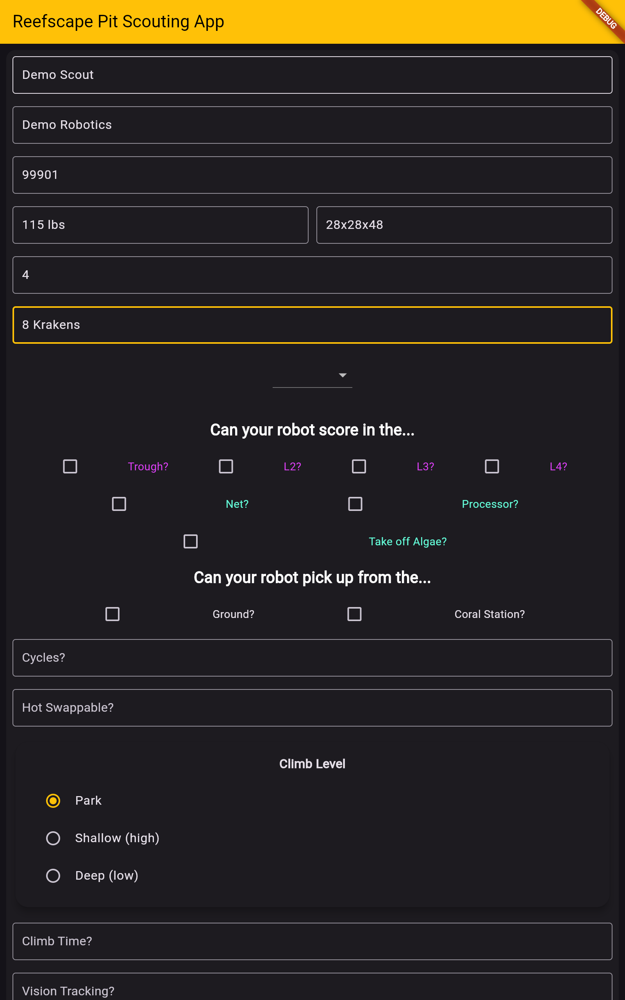
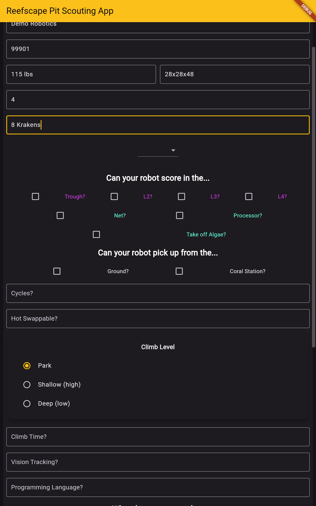
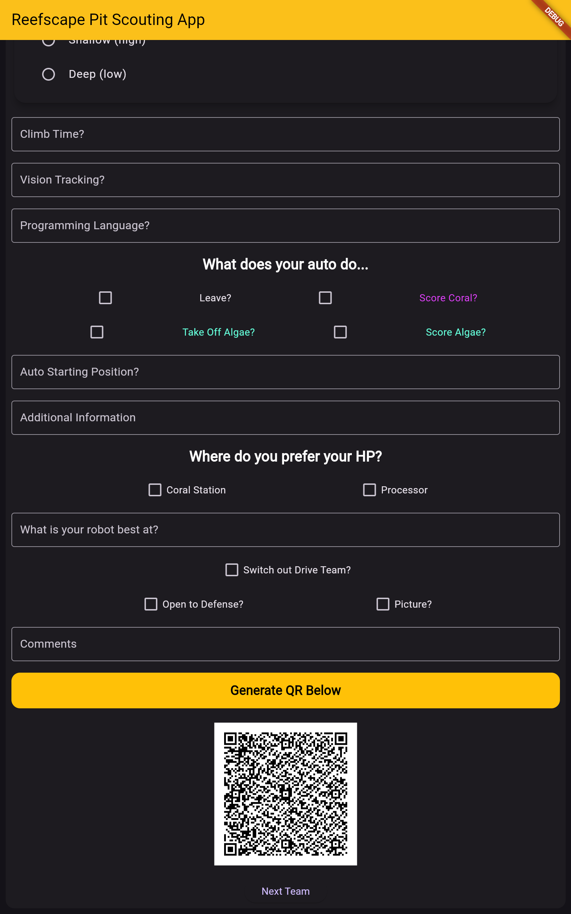
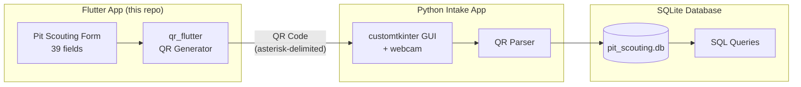

# FRC 2025 Reefscape Pit Scouting App

<div align="center">

[](https://developer.android.com/)
[](https://flutter.dev/)
[](https://dart.dev/)
[](https://firstfrc.blob.core.windows.net/frc2025/Manual/2025GameManual.pdf)

**Cross-platform pit scouting app that captures robot specifications as QR codes for offline data collection at FRC competitions.**

[Features](#features) · [Screenshots](#screenshots) · [Architecture](#architecture) · [Usage Stats](#usage-stats) · [Build](#build-instructions)

</div>

---

## Background

As a freshman on [FRC Team 1730 (Team Driven)](https://www.thebluealliance.com/team/1730/2025), I served as scout lead during the 2022 Rapid React season. Seniors Heath Crump and Caden Findlay led the scouting app that year — we made it to the Newton Division at the Houston Championship and reached Einstein. I learned everything about scouting strategy working under them.

Sophomore year (2023), I became the solo developer, building the match scouting app in Java/Android with QR codes scanned into Excel. Junior year (2024), I kept it going and added a separate pit scouting app. Senior year (2025, this repo), I rewrote both apps in Dart/Flutter for cross-platform support. The QR workflow remained, but the data now flows into a Python/customtkinter intake app that writes to SQLite — so strategy questions become SQL queries instead of spreadsheet filters.

— [Aamir Abatiyow](https://github.com/AamirAbatiyow)

## Screenshots

<div align="center">
<table>
  <tr>
    <td align="center"><br/><b>Pit Scouting Form</b></td>
    <td align="center"><br/><b>Scoring & Climb</b></td>
    <td align="center"><br/><b>QR Code Export</b></td>
  </tr>
</table>

<sub>Rendered at 10" portrait tablet size, the devices the team scouted on.</sub>
</div>

## Features

- **39 Comprehensive Data Fields** — Captures team info, robot dimensions, drivetrain configuration, scoring capabilities, autonomous routines, and strategic preferences
- **Reefscape-Specific Scoring** — Tracks all 2025 game elements: Coral placement (Trough, L2–L4), Algae handling (Net, Processor), and Barge climb levels (Park, Shallow, Deep)
- **Detailed Drivetrain Analysis** — Cascading dropdowns for swerve modules (SDS L1–L4, WCP X/X2, REV, ThriftyBot variants)
- **QR Code Export** — One-tap generation of scannable QR codes containing all scouted data
- **Dark Theme UI** — Easy on the eyes in competition lighting with amber accents matching Team 1730's identity
- **Cross-Platform** — Single Flutter codebase compiles for Android, iOS, web, and desktop

## Usage Stats

Used at **3 events** to scout **147 teams**, collecting **5,733 data points** across 39 fields per robot:

| Event | Teams | Link |
|:------|------:|:-----|
| Heartland Regional | 36 | [2025ksla](https://www.thebluealliance.com/event/2025ksla) |
| Greater Kansas City Regional | 36 | [2025mokc](https://www.thebluealliance.com/event/2025mokc) |
| Newton Division (Houston Championship) | 75 | [2025new](https://www.thebluealliance.com/event/2025new) |

<sub>Data points = teams × 39 fields. Team page: [Team 1730 on TBA](https://www.thebluealliance.com/team/1730/2025)</sub>

## Architecture



### Data Flow

1. **Collect** — Scouts fill out the pit scouting form on Android tablets during competition
2. **Export** — The app serializes all 39 fields into asterisk-delimited text and renders a QR code
3. **Scan** — Scouting lead uses a Python/customtkinter app to scan QR codes via webcam
4. **Store** — Parser validates and inserts each record into SQLite
5. **Analyze** — Strategy questions become SQL queries against the local database

### QR Payload Schema (39 Fields)

```
TeamName*TeamNumber*Weight*Dimensions*Cycles*Mechanisms*DrivetrainMotors*
HotSwappable*ClimbTime*AutoStart*VisionTracking*ProgrammingLanguage*
AutoInfo*BestAt*Comments*DrivetrainType*SwerveModule*SDSLevel*WCPLevel*
ThriftyBotType*Trough*L2*L3*L4*Net*Processor*TakeOffAlgae*GroundPickup*
StationPickup*BargeLevel*AutoScoreAlgae*AutoScoreCoral*Leave*AutoTakeOffAlgae*
ProcessorHP*StationHP*Defense*DriveTeamSwitch*Picture
```

## Build Instructions

### Requirements

- [Flutter SDK](https://docs.flutter.dev/get-started/install) 3.6.0 or later
- For Android: Android Studio or `flutter build apk`
- For web: Chrome or any modern browser
- For desktop: Platform-specific toolchains ([Linux](https://docs.flutter.dev/platform-integration/linux/building), [Windows](https://docs.flutter.dev/platform-integration/windows/building), [macOS](https://docs.flutter.dev/platform-integration/macos/building))

### Steps

```bash
# Clone the repository
git clone https://github.com/aamir-frc-scouting/frc_pit_scouting_app_2025.git
cd frc_pit_scouting_app_2025

# Install dependencies
flutter pub get

# Run on connected device or emulator
flutter run

# Or run on web
flutter run -d chrome

# Or build release APK
flutter build apk --release
```

## What Came Next

The 2025 rewrite solved problems from the Java/Android era:

| Challenge | 2024 Approach | 2025 Solution |
|-----------|---------------|---------------|
| Platform lock-in | Android-only Java app | Flutter compiles for Android, iOS, web, desktop |
| Manual data entry | Scan QR → paste into Excel tabs | Python intake app validates and writes to SQLite |
| Ad-hoc queries | Filter/pivot in spreadsheet | SQL queries against normalized tables |

QR codes stayed because competition WiFi is unreliable. Scouts generate, screenshot, and the scouting lead batch-processes later — no network dependency during matches.

## Tech Stack

| Component | Technology |
|-----------|------------|
| Framework | Flutter 3.24+ |
| Language | Dart 3.5+ |
| QR Generation | [qr_flutter](https://pub.dev/packages/qr_flutter) |
| Camera (planned) | [camera](https://pub.dev/packages/camera) |
| File Paths | [path_provider](https://pub.dev/packages/path_provider) |
| Linting | [flutter_lints](https://pub.dev/packages/flutter_lints) |

## License

This repository does not currently have a license. Please contact the author before using this code in your own projects.

---

<div align="center">

**Part of the [Team 1730 scouting system](https://github.com/aamir-frc-scouting)**

[2023 Match](https://github.com/aamir-frc-scouting/frc-scouting-app-2023) · [2024 Match](https://github.com/aamir-frc-scouting/frc-scouting-app-2024) · [2024 Pit](https://github.com/aamir-frc-scouting/frc-pit-scouting-app-2024) · [2025 Match](https://github.com/aamir-frc-scouting/frc-scouting-app-2025) · **2025 Pit**

</div>
