# FRC Pit Scouting App 2025

[](https://flutter.dev)
[](https://dart.dev)
[](https://flutter.dev/multi-platform)
[](https://www.firstinspires.org/robotics/frc)

> Cross-platform pit scouting app for FRC 2025 Reefscape — capturing robot specs as QR codes for rapid data collection at competition.

Part of [FRC Team 1730 (Team Driven)](https://www.thebluealliance.com/team/1730)'s scouting suite, developed by Aamir Abatiyow. See the full [aamir-frc-scouting](https://github.com/aamir-frc-scouting) organization for match scouting apps and more.

## Screenshots

<table>
  <tr>
    <td align="center"><strong>Pit Scouting Form</strong></td>
    <td align="center"><strong>Scoring Capabilities</strong></td>
    <td align="center"><strong>QR Code Export</strong></td>
  </tr>
  <tr>
    <td></td>
    <td></td>
    <td></td>
  </tr>
</table>

## Features

- **39 Comprehensive Data Fields** — Captures everything scouts need: team info, robot dimensions, drivetrain configuration, scoring capabilities, autonomous routines, and strategic preferences
- **Reefscape-Specific Scoring** — Tracks all 2025 game elements: Coral placement (Trough, L2-L4), Algae handling (Net, Processor), and Barge climb levels
- **Detailed Drivetrain Analysis** — Cascading dropdowns for swerve modules (SDS L1-L4, WCP X/X2, REV, ThriftyBot variants)
- **QR Code Export** — One-tap generation of scannable QR codes containing all scouted data
- **Dark Theme UI** — Easy on the eyes in competition lighting with amber accent colors matching Team 1730's identity
- **Cross-Platform** — Runs on Android, iOS, web browsers, and desktop (Windows, macOS, Linux)

## Field Season Stats

Used at **3 events** to scout **147 teams**, collecting **5,733 data points** across 39 fields per robot:

| Event | Teams | Link |
|-------|------:|------|
| Heartland Regional | 36 | [2025ksla](https://www.thebluealliance.com/event/2025ksla) |
| Greater Kansas City Regional | 36 | [2025mokc](https://www.thebluealliance.com/event/2025mokc) |
| Newton Division (Houston Championship) | 75 | [2025new](https://www.thebluealliance.com/event/2025new) |

## Architecture

```mermaid
flowchart LR
    subgraph App["Flutter App"]
        Form["Pit Scouting Form<br/>(39 fields)"]
        State["StatefulWidget<br/>State Management"]
        Format["Data Formatter<br/>(asterisk-delimited)"]
        QRGen["qr_flutter<br/>QR Generator"]
    end

    subgraph Data["Data Fields"]
        Team["Team Info<br/>Name, Number, Weight"]
        Drive["Drivetrain<br/>Swerve/Tank + Module"]
        Score["Scoring<br/>Coral L2-L4, Algae"]
        Auto["Autonomous<br/>Start, Actions, Leave"]
        Climb["Endgame<br/>Park/Shallow/Deep"]
    end

    subgraph Export["Export Flow"]
        QRCode["QR Code<br/>(on-screen)"]
        Scan["Scanner Device"]
        Database["Team Database"]
    end

    Data --> Form
    Form --> State
    State --> Format
    Format --> QRGen
    QRGen --> QRCode
    QRCode -.->|"Manual Scan"| Scan
    Scan -.-> Database
```



### Data Flow

1. **Input** — Scouts enter robot data through text fields, dropdowns, checkboxes, and radio buttons
2. **State** — Flutter's `StatefulWidget` manages all 39 field values with `TextEditingController` and boolean/enum state
3. **Format** — `formatData()` serializes fields into asterisk-delimited text (e.g., `TeamName*1730*115*...`)
4. **Generate** — `qr_flutter` renders the payload as a QR code displayed on-screen
5. **Export** — Scouts screenshot or scan the QR code; receiving systems parse the delimited data

### QR Payload Schema (39 Fields)

```
TeamName*TeamNumber*Weight*Dimensions*Cycles*Mechanisms*DrivetrainMotors*
HotSwappable*ClimbTime*AutoStart*VisionTracking*ProgrammingLanguage*
AutoInfo*BestAt*Comments*DrivetrainType*SwerveModule*SDSLevel*WCPLevel*
ThriftyBotType*Trough*L2*L3*L4*Net*Processor*TakeOffAlgae*GroundPickup*
StationPickup*BargeLevel*AutoScoreAlgae*AutoScoreCoral*Leave*AutoTakeOffAlgae*
ProcessorHP*StationHP*Defense*DriveTeamSwitch*Picture
```

## Why Flutter + QR Codes

| Decision | Rationale |
|----------|-----------|
| **Flutter** | Single codebase deploys to Android tablets (primary), iOS devices, web browsers for backup, and desktop for development. Material Design provides consistent UI. |
| **QR Codes** | Works offline in venues with unreliable WiFi. No server dependency during matches. Scouts generate, screenshot, and the scouting lead batch-processes later. |
| **StatefulWidget** | Simple state management for a form-centric app. No external state library overhead for a single-screen workflow. |
| **qr_flutter** | Pure Dart QR generation with no native dependencies, ensuring cross-platform compatibility. |

## Getting Started

### Prerequisites

- [Flutter SDK](https://docs.flutter.dev/get-started/install) 3.5.0 or later
- For Android: Android Studio or `flutter build apk`
- For iOS: Xcode (macOS only)
- For Web: Chrome or any modern browser
- For Desktop: Platform-specific toolchains ([Linux](https://docs.flutter.dev/platform-integration/linux/building), [Windows](https://docs.flutter.dev/platform-integration/windows/building), [macOS](https://docs.flutter.dev/platform-integration/macos/building))

### Installation

```bash
# Clone the repository
git clone https://github.com/aamir-frc-scouting/frc_pit_scouting_app_2025.git
cd frc_pit_scouting_app_2025

# Install dependencies
flutter pub get

# Run on connected device or emulator
flutter run

# Or run on web
flutter run -d chrome

# Or build APK for Android
flutter build apk --release
```

### Build Notes

> **SDK Compatibility**: The original `pubspec.yaml` requires Dart SDK ^3.6.0. If using Flutter 3.24.x (Dart 3.5.x), adjust the SDK constraint to `^3.5.0` and camera to `^0.11.0+2`.

## Tech Stack

| Component | Technology |
|-----------|------------|
| Framework | Flutter 3.24+ |
| Language | Dart 3.5+ |
| QR Generation | [qr_flutter](https://pub.dev/packages/qr_flutter) |
| Camera (optional) | [camera](https://pub.dev/packages/camera) |
| File Paths | [path_provider](https://pub.dev/packages/path_provider) |
| Icons | [cupertino_icons](https://pub.dev/packages/cupertino_icons) |
| Linting | [flutter_lints](https://pub.dev/packages/flutter_lints) |

## Project Context

This app is part of Aamir Abatiyow's 2023–2025 FRC scouting app development for Team 1730 (Team Driven). The 2025 season marked a technology transition:

- **2023–2024**: Java/Android apps with QR codes scanned into Excel workbooks
- **2025**: Dart/Flutter rewrite enabling cross-platform deployment

The companion [match scouting app](https://github.com/aamir-frc-scouting/frc-scouting-app-2025) tracks in-match robot performance, while this pit scouting app captures static robot specifications before matches begin.

## License

This repository does not currently have a license. See the pull request for a recommendation.

---

<p align="center">
  <a href="https://github.com/aamir-frc-scouting">aamir-frc-scouting</a> · 
  <a href="https://www.thebluealliance.com/team/1730">Team 1730 on TBA</a>
</p>
